# Preliminary and Detailed Design

## Event Ticketing and Check-in System

Prepared by: Luma Chrisparr Ngale Jomia  
Matricule: FE25A114  
Role: Analysis Lead  
Status: Group design draft based on the confirmed SRS

This document turns the confirmed requirements in [`srs.md`](srs.md) into a design the group can build and review. The diagrams below use Mermaid so they can be viewed in GitHub and edited as text. The architecture diagram is also provided as an SVG at [`diagrams/architecture.drawio.svg`](diagrams/architecture.drawio.svg).

Luma's personal Event Ticketing ERD is in the [Week 1 repository](https://github.com/Software-Dev-Tools-Gr-10/cef345--week1/tree/main/Luma%20cef345week1). The [registration sequence diagram](https://github.com/Software-Dev-Tools-Gr-10/cef345--week1/blob/main/Luma%20cef345week1/Luma-registration-sequence.drawio.svg) is also available as an SVG.

## 1. Preliminary design

### Architecture choice

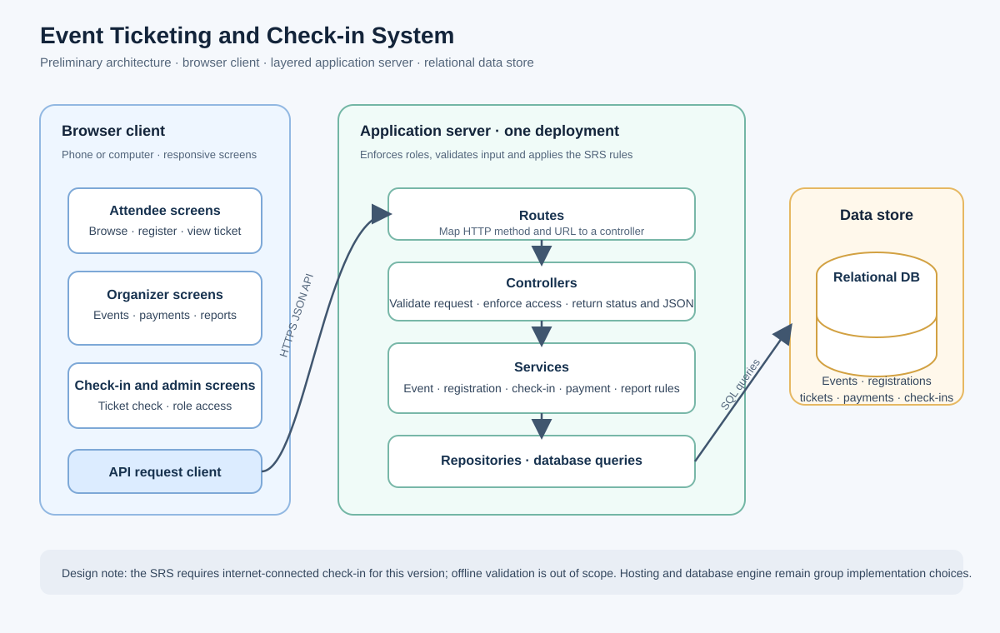

The system will use a browser-based client and a client-server monolith with layered server responsibilities. Attendees, organizers, check-in staff and the system administrator use responsive browser screens. The browser sends requests to one application server, which applies role checks and event rules before reading or changing data through a repository layer. The database stores event, registration, ticket, payment and attendance records.

This is a good fit for the confirmed SRS because visitors need to browse and register for published events (FR-03–FR-07), organizers need to manage event records (FR-01–FR-02, FR-08–FR-09, FR-13–FR-14), check-in staff need fast ticket validation (FR-10–FR-12), and the administrator needs to manage roles (FR-15). Keeping the layers in one deployable application is manageable for a student group, while role checks and data rules stay on the server (NFR-04). A separate service per feature would add deployment and coordination work without a requirement that needs it.

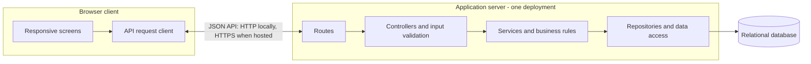

### Deployment view

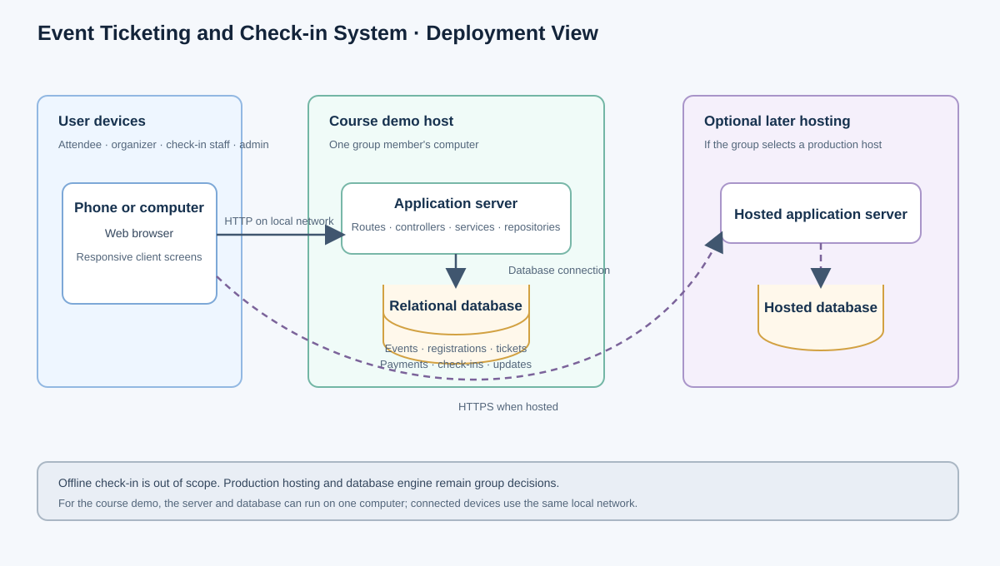

For development and the course demonstration, the application server and database can run on one group member's computer. Other phones or computers can open the system through a browser on the same network. The production host and database engine are not specified in the confirmed SRS, so those remain deployment choices for the group.

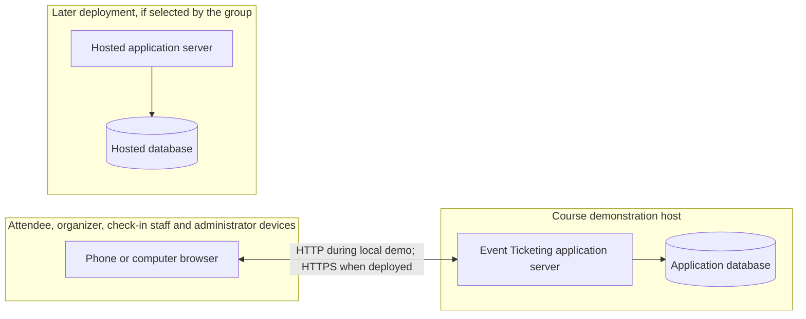

### Data model

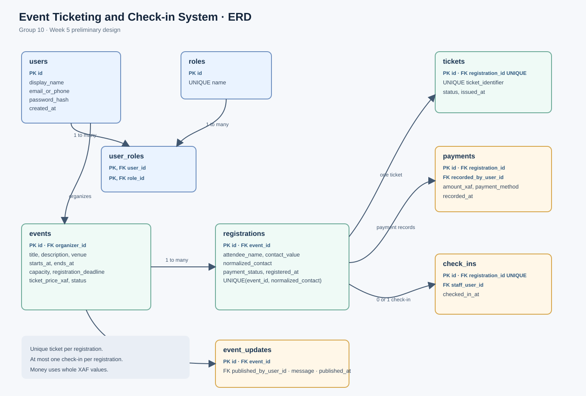

The proposed relational model keeps registrations and attendance history tied to events and attendees. A ticket belongs to one registration, and one registration can have at most one check-in. Payment records are separate so the system can retain the amount, method and recorded date required by FR-09. Contact values are normalized before checking for a duplicate registration as described in FR-05.

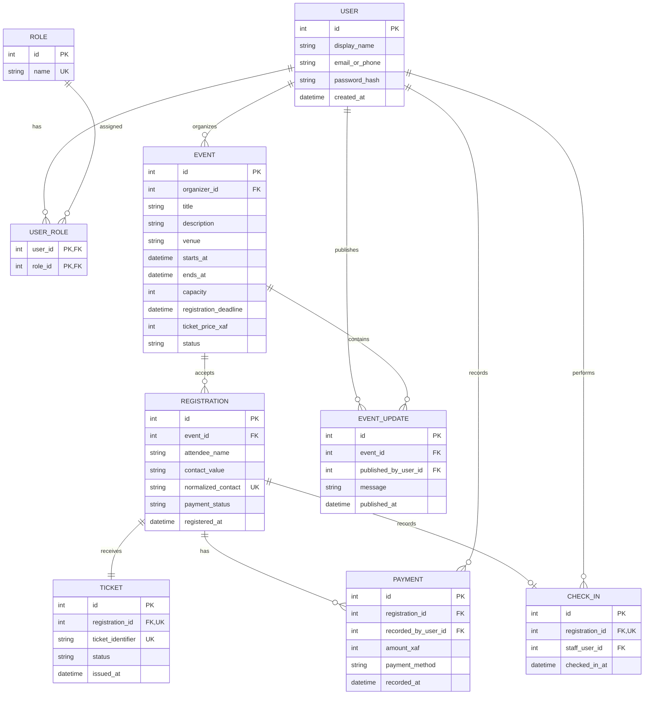

### Table and column summary

| Table | Columns | Purpose and key rules |
|---|---|---|
| `users` | `id` PK, `display_name`, `email_or_phone`, `password_hash`, `created_at` | Staff and organizer accounts. Passwords are stored as hashes, never plain text. |
| `roles` | `id` PK, `name` unique | Role values include Organizer, Check-in staff and System administrator. |
| `user_roles` | `user_id` PK/FK, `role_id` PK/FK | Allows an account to hold more than one role; the pair is unique. |
| `events` | `id` PK, `organizer_id` FK, `title`, `description`, `venue`, `starts_at`, `ends_at`, `capacity`, `registration_deadline`, `ticket_price_xaf`, `status` | Event details and lifecycle. Capacity must be positive; ticket price must be zero or greater; end time must follow start time. |
| `registrations` | `id` PK, `event_id` FK, `attendee_name`, `contact_value`, `normalized_contact`, `payment_status`, `registered_at` | One attendee registration. `payment_status` is `unpaid` or `paid` and starts as `unpaid`. Enforce unique `(event_id, normalized_contact)` and capacity/deadline checks in the registration service. |
| `tickets` | `id` PK, `registration_id` unique/FK, `ticket_identifier` unique, `status`, `issued_at` | One unique ticket per successful registration. |
| `payments` | `id` PK, `registration_id` FK, `recorded_by_user_id` FK, `amount_xaf`, `payment_method`, `recorded_at` | Payment details recorded by an authorized organizer for a registration. Amounts are whole XAF values and non-negative. The registration stores the explicit unpaid/paid status. |
| `check_ins` | `id` PK, `registration_id` unique/FK, `staff_user_id` FK, `checked_in_at` | A registration can be checked in once. The unique key prevents a second successful check-in. |
| `event_updates` | `id` PK, `event_id` FK, `published_by_user_id` FK, `message`, `published_at` | Updates visible to attendees registered for that event. |

### API endpoint contract

All successful endpoints return JSON. Errors use one shape: `{"error":"ERROR_CODE","message":"What happened"}`. The server checks the user's role for every protected action. The exact authentication method is left open for the implementation, but the server must enforce NFR-04.

| Method and path | Use | Success | Main errors | Requirement IDs |
|---|---|---|---|---|
| `POST /api/auth/login` | Authenticate a staff account and establish its session | `200` | `401` invalid credentials | Supports protected actions in NFR-04; login behavior needs its own requirement if included in scope |
| `POST /api/events` | Create a draft event | `201` | `400` invalid details, `403` wrong role | FR-01 |
| `PATCH /api/events/:eventId` | Update, publish, close or cancel an event | `200` | `400` invalid state/details, `403`, `404` | FR-02 |
| `GET /api/events` | List published events and registration status/capacity | `200` | `500` | FR-03 |
| `GET /api/events/:eventId` | View one published event | `200` | `404` | FR-03 |
| `POST /api/events/:eventId/registrations` | Register one attendee and create a ticket | `201` | `400` bad data, `404` event, `409` closed/full/late/duplicate | FR-04, FR-05, FR-06 |
| `GET /api/tickets/:ticketIdentifier` | View ticket and event details | `200` | `404` | FR-07 |
| `GET /api/events/:eventId/registrations?search=` | Search attendee list | `200` | `403`, `404` | FR-08 |
| `POST /api/registrations/:registrationId/payments` | Record an amount, method and date for payment | `201` | `400`, `403`, `404` | FR-09 |
| `POST /api/events/:eventId/check-ins` | Validate a ticket and record check-in | `201` | `400` missing ID, `403`, `404`, `409` invalid/wrong event/already checked in | FR-10, FR-11, FR-12 |
| `POST /api/events/:eventId/updates` | Publish an event update | `201` | `400`, `403`, `404` | FR-13 |
| `GET /api/tickets/:ticketIdentifier/updates` | View updates for the event linked to a valid ticket | `200` | `404` invalid ticket | FR-13 |
| `GET /api/events/:eventId/report` | Return registration, paid, amount-paid and checked-in totals | `200` | `403`, `404` | FR-14 |
| `PUT /api/admin/users/:userId/roles` | Assign or remove Organizer and Check-in staff roles | `200` | `400`, `403`, `404` | FR-15 |
| `GET /api/events/:eventId/report.csv` | Export attendee and attendance report | `200` | `403`, `404` | FR-16 |

The API paths and status codes are a proposed design contract. The group should keep the route names stable once implementation begins, or update this table and its traceability together.

#### Example: register an attendee

Request:

```http
POST /api/events/42/registrations
Content-Type: application/json

{
  "name": "Mireille N.",
  "contact": "mireille@example.com"
}
```

Success (`201 Created`):

```json
{
  "registrationId": 318,
  "ticket": {
    "identifier": "EVT-42-7KQ4",
    "status": "valid"
  },
  "event": {
    "id": 42,
    "title": "Youth Fellowship"
  }
}
```

If capacity is full or the contact has already registered, return `409 Conflict` and explain the reason without creating a registration or ticket.

### Requirement traceability

| Requirement | Endpoint(s) | Data tables |
|---|---|---|
| FR-01 | `POST /api/events` | `users`, `events` |
| FR-02 | `PATCH /api/events/:eventId` | `users`, `events` |
| FR-03 | `GET /api/events`, `GET /api/events/:eventId` | `events`, `registrations` |
| FR-04 | `POST /api/events/:eventId/registrations` | `events`, `registrations` |
| FR-05 | `POST /api/events/:eventId/registrations` | `events`, `registrations` |
| FR-06 | `POST /api/events/:eventId/registrations` | `registrations`, `tickets` |
| FR-07 | `GET /api/tickets/:ticketIdentifier` | `tickets`, `registrations`, `events` |
| FR-08 | `GET /api/events/:eventId/registrations?search=` | `events`, `registrations` |
| FR-09 | `POST /api/registrations/:registrationId/payments` | `registrations`, `payments`, `users` |
| FR-10 | `POST /api/events/:eventId/check-ins` | `events`, `tickets`, `registrations` |
| FR-11 | `POST /api/events/:eventId/check-ins` | `events`, `tickets`, `registrations`, `check_ins` |
| FR-12 | `POST /api/events/:eventId/check-ins` | `check_ins`, `users` |
| FR-13 | `POST /api/events/:eventId/updates`, `GET /api/tickets/:ticketIdentifier/updates` | `events`, `event_updates`, `registrations`, `tickets` |
| FR-14 | `GET /api/events/:eventId/report` | `events`, `registrations`, `payments`, `check_ins` |
| FR-15 | `PUT /api/admin/users/:userId/roles` | `users`, `roles`, `user_roles` |
| FR-16 | `GET /api/events/:eventId/report.csv` | `events`, `registrations`, `tickets`, `payments`, `check_ins` |

## 2. Design decisions

### D-01: Use a browser client and layered application server

Date: 2026-11-21  
Context: The confirmed SRS needs public event browsing and registration alongside protected event management, reporting and check-in actions (FR-01–FR-15). The group is building a course project with limited time.  
Decision: Use a responsive browser client and one application server organized into routes, controllers, services and repositories.  
Consequences: The group can deploy one application and keep business rules in services. The server can serve multiple screen sizes. The server remains a single point of availability, and local check-in requires a network connection as stated in the SRS.

### D-02: Use a relational data model with event-linked records

Date: 2026-11-21  
Context: Tickets, registrations, payments and check-ins must remain connected to the correct event, and the report must count these records accurately (FR-05–FR-14).  
Decision: Use relational tables with primary keys, foreign keys, uniqueness constraints and transactions for registration and check-in operations. The database engine is a group implementation choice.  
Consequences: Referential integrity helps prevent orphan tickets and attendance records. The schema needs migrations if fields change. The chosen engine and hosting arrangement must be added once the group agrees on them.

## 3. Detailed design

### Class and module diagram

The project can use classes or modules. In this diagram, service and repository boxes represent modules with the listed responsibilities.

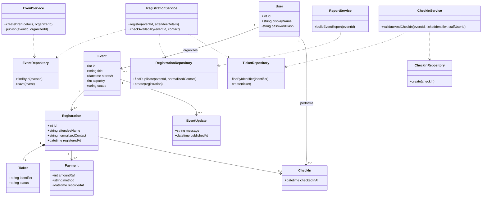

### Sequence: create and publish an event

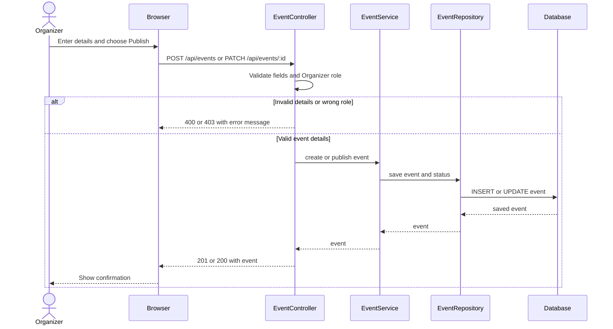

### Sequence: register and receive a ticket

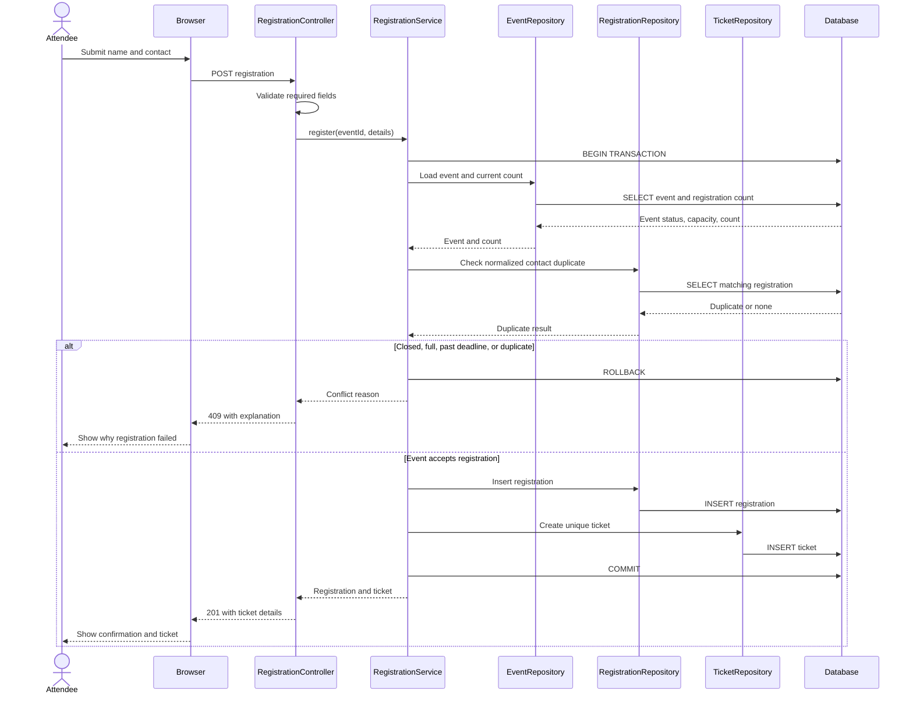

### Sequence: validate a ticket and check in

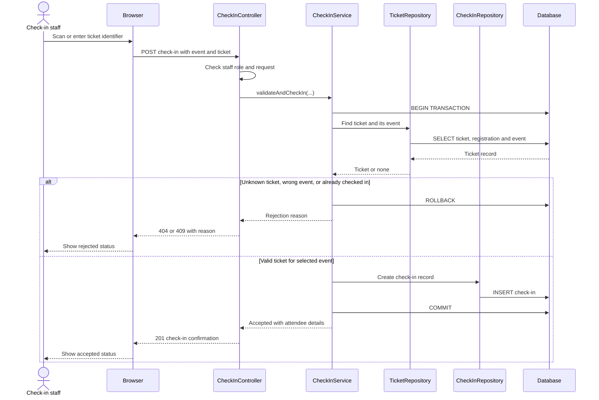

### Activity diagram: event registration through attendance

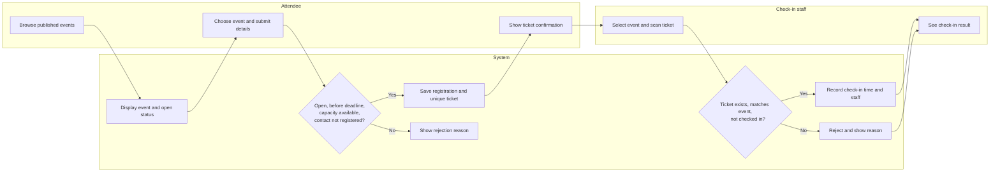

### Wireframes

These are low-fidelity screen layouts. They use only the information and actions in the confirmed SRS.

#### Attendee event and registration screen

```text
+--------------------------------------------------+
| Event Ticketing                         [Events] |
+--------------------------------------------------+
| Youth Fellowship                                 |
| Sat 12 Dec, 10:00  |  Community Hall             |
| Free / Ticket price: [shown from event]          |
| Registration: OPEN  |  Places left: [count]      |
|                                                  |
| Name:    [________________________________]      |
| Contact: [________________________________]      |
|                                                  |
|              [ Register for event ]              |
+--------------------------------------------------+
| After success: ticket identifier + event details |
+--------------------------------------------------+
```

#### Organizer dashboard and event report

```text
+--------------------------------------------------+
| Organizer dashboard                    [Account]|
+--------------------------------------------------+
| [Create event]                                   |
|                                                  |
| My events       Title          Status    [Open]  |
|                 Youth meet     Published [Edit] |
|                 Career fair    Closed    [Report]|
|                                                  |
| Event report: Career fair                       |
| Registrations [n]  Paid [n]  Amount paid [XAF]  |
| Checked in [n]    [Export CSV]                   |
|                                                  |
| [Publish update] [Close event] [Cancel event]    |
+--------------------------------------------------+
```

#### Check-in screen

```text
+--------------------------------------------------+
| Event check-in                                   |
+--------------------------------------------------+
| Selected event: [Youth Fellowship          v]   |
|                                                  |
| Ticket identifier: [____________________] [Scan]|
|                         [ Check ticket ]         |
|                                                  |
| Result: VALID / REJECTED                         |
| Attendee: [minimum details for identification]  |
| Reason if rejected: [not found / wrong event /   |
|                       already checked in]        |
+--------------------------------------------------+
```

### Pseudocode: register attendee and issue ticket

The registration operation must not exceed event capacity or issue two tickets for the same event/contact. The service performs the state checks and inserts in one transaction. A database uniqueness constraint on `(event_id, normalized_contact)` is the final guard against simultaneous duplicate submissions. Since the database engine is still a group choice, `findByIdForUpdate` below means the implementation must lock or otherwise serialize capacity updates using the chosen engine's supported approach.

```text
function registerAttendee(eventId, name, contact):
    if name is blank or contact is blank:
        throw ValidationError("Name and contact are required")

    normalizedContact = lowercase(trim(contact))
    begin transaction
    try:
        event = eventRepository.findByIdForUpdate(eventId)
        if event does not exist:
            throw NotFoundError("Event not found")
        if event.status is not "published":
            throw ConflictError("Registration is closed")
        if currentTime is after event.registrationDeadline:
            throw ConflictError("Registration deadline has passed")
        if registrationRepository.exists(eventId, normalizedContact):
            throw ConflictError("This contact is already registered")
        if registrationRepository.countForEvent(eventId) >= event.capacity:
            throw ConflictError("Event is full")

        registration = registrationRepository.create(
            eventId, name, contact, normalizedContact, currentTime
        )
        ticketIdentifier = generateUniqueTicketIdentifier(eventId)
        ticketRepository.create(
            registration.id, ticketIdentifier, "valid", currentTime
        )
        commit transaction
        return registration with ticketIdentifier
    catch UniqueConstraintError for (eventId, normalizedContact):
        rollback transaction
        throw ConflictError("This contact is already registered")
    catch any error:
        rollback transaction
        rethrow error
```

## 4. Review checklist

- Every functional requirement FR-01 through FR-16 maps to at least one endpoint and the data it uses in the traceability table.
- Protected endpoints require the relevant role; public event browsing and registration are available without staff roles.
- Registration refuses closed, late, full and duplicate requests without leaving partial records; capacity checks are serialized so concurrent requests cannot exceed the event limit.
- Each successful registration creates one ticket; each registration can have no more than one successful check-in.
- API errors explain invalid input, missing records, forbidden actions and conflicts.
- The three main sequences show an alternative path, and the registration sequence includes the transaction boundary.
- Wireframes fit a phone browser; the check-in screen exposes only the minimum attendee information needed by staff (NFR-03, NFR-07).
- Before implementation, confirm the database engine, host, authentication method and whether login/account creation need separate SRS requirements.

## 5. Remaining Week 6 group task

The handout also asks the group to review another group's detailed design and post findings as issues labelled `design-review` in that group's repository. That peer review must use the actual group's design files and should be recorded separately from this project design.
